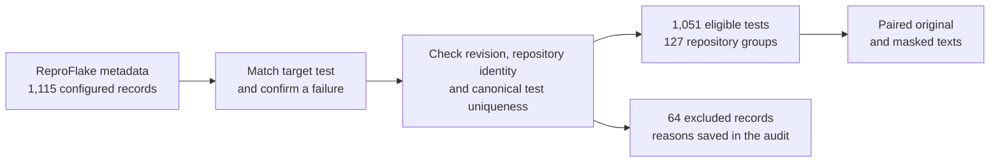
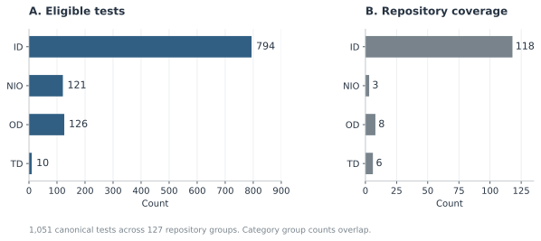
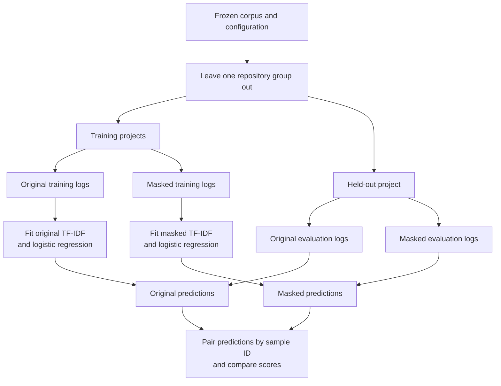
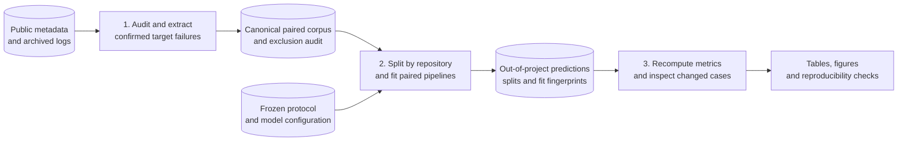
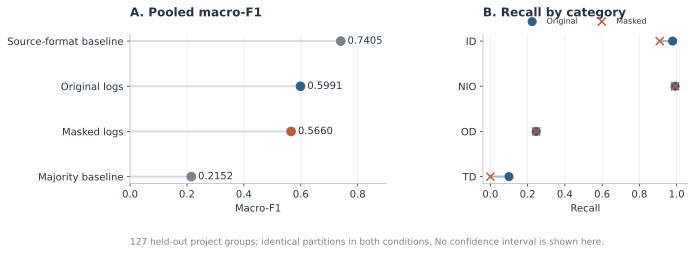
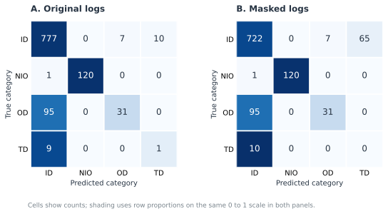

# Identifier Masking in Flaky Test Classification

**A reproducible cross-project experiment on Java failure logs.**

Aruzhan Kartam · Saniya Yerzhan · Vitaliy Golubenko  
Astana IT University

[Research question](#research-question) · [Dataset](#dataset) · [Experiment](#experiment) · [Results](#results) · [Run the code](#run-the-code) · [Repository map](#repository-map) · [References](#references)

| Corpus | Evaluation | Model | Reproduction |
| :--- | :--- | :--- | :--- |
| 1,051 canonical tests | 127 held-out repository groups | TF-IDF + logistic regression | Python 3.12, fixed configuration, saved predictions |

This repository contains the computational part of a study of identifier sensitivity in flaky-test category classification. Each eligible failure log has an original representation and a version with selected project, test and path identifiers replaced. Both conditions use the same held-out projects and independently fitted models.

**Main observation:** pooled macro-F1 falls from **0.5991 to 0.5660** after masking. All 56 changed predictions become incorrect. This result is specific to the retained corpus and model: strong source-format confounding, category imbalance and concentrated project coverage limit generalisation.

## Research question

> How does masking project and test identifiers in failure logs affect the macro-F1 of flaky-test category classification on previously unseen Java projects?

The study tests whether a text classifier depends on identifier information when it encounters another project. A random split of log rows would not answer this question: related tests and repeated runs could occur in both partitions. We therefore keep repository groups disjoint and retain one confirmed target failure per canonical test.

The experiment measures sensitivity to a defined text transformation. It does not identify the cause of a flaky test or establish that identifier removal improves classification in general.

## Dataset

The corpus is derived from **ReproFlake** metadata and archived execution results. The public repository contains code, aggregate results and figures. Research logs and the compressed data snapshot are distributed separately and are not committed here. The code uses the exact retained texts, provenance, exclusions and reference predictions from the original research workspace.





| Label | Category | Tests | Repository groups |
| :--- | :--- | ---: | ---: |
| ID | Implementation-dependent | 794 | 118 |
| NIO | Non-idempotent-outcome | 121 | 3 |
| OD | Order-dependent | 126 | 8 |
| TD | Time-dependent | 10 | 6 |

Repository counts overlap across categories. Of the 121 NIO tests, 116 come from `junit-quickcheck`; 120 of 127 repository groups contain only one observed category. These facts matter when interpreting both class-level and project-level scores.

**Selection:** 25 records have no failure in the outcome table, 23 have no confirmed target diagnostic, 9 are unclassified, 6 lack a valid revision, and 1 has unresolved revision attribution. A failure mentioned in metadata alone is insufficient for inclusion.

[Data schema and provenance](docs/DATA.md) · [Reference snapshot checksums](artifacts/manifest.json) · [Data attribution](THIRD_PARTY.md)

## Experiment

### Paired project-disjoint evaluation

For each of 127 folds, one repository group is held out. Original and masked conditions use identical sample IDs in their training and evaluation sets. TF-IDF is fitted only on the training partition. Each condition receives a fresh vectorizer and classifier.



| Component | Fixed setting |
| :--- | :--- |
| Features | Word unigrams and bigrams; lowercase; sublinear term frequency; L2 normalisation |
| Vocabulary | At most 30,000 features; `min_df=1`; fitted within each training fold |
| Classifier | Logistic regression; `C=1`; balanced class weights; `lbfgs`; up to 2,000 iterations |
| Split | `LeaveOneGroupOut` using canonical repository network roots |
| Random seed | `20261013` |
| Computation | One numerical computation thread; 254 main classifier fits |
| Comparators | Training-fold majority class and training-fold source-format lookup |
| Tuning | Fixed numerical hyperparameters; no search or separate validation partition |

See the exact [configuration](config_model_v3.json) and [methodological rationale](docs/METHODS.md). The original Russian protocol files are preserved so their recorded hashes remain verifiable.

### What masking changes

Selected identifiers become `PROJECT`, `TEST_CLASS`, `TEST_METHOD` or `PROJECT_PATH`. Exception types and protected framework names are preserved. This is a defined partial masking operation, not complete anonymisation.

A real retained ActiveMQ example:

```text
Original:
at org.apache.activemq.transport.stomp.StompTest.testTransformationReceiveJSONObject(StompTest.java:1113)

Masked:
at org.apache.PROJECT.transport.stomp.StompTest.TEST_METHOD(StompTest.java:1113)
```

`StompTest` remains because it is not the configured target class. Such residual tokens are part of the method's limitations. The demo trains both models for this held-out project and checks their predictions against the saved evidence.

### Data flow



## Results

### Main comparison

| Condition | Pooled macro-F1 | Mean project macro-F1 |
| :--- | ---: | ---: |
| Original logs | **0.5991** | **0.9127** |
| Masked logs | 0.5660 | 0.8699 |
| Majority-class baseline | 0.2152 | 0.8907 |
| Source-format baseline | 0.7405 | 0.9619 |



The two macro-F1 columns answer different questions. Pooled macro-F1 gives each of the four labels equal weight across all held-out predictions. Mean project macro-F1 averages fold scores computed over labels present in that held-out project. With mostly single-category projects, a high project average can coexist with poor rare-category performance.

- **Pooled macro-F1 change:** -0.0330 (masked minus original).
- **Mean paired project change:** -0.0429; descriptive project-bootstrap 95% interval **[-0.0808, -0.0120]**, using 5,000 resamples.
- **Changed predictions:** 56 across 10 groups, all correct-to-incorrect; 45 occur in ActiveMQ.
- **Transition pattern:** 55 ID predictions switch to TD; one TD prediction switches to ID.

The interval describes this corpus under resampling of observed project deltas. Overlapping training folds and sparse rare-category coverage prevent a broad causal or population-level interpretation.



### What explains the result?

The strongest warning is the **source-format baseline**, which outperforms both text models. In this corpus, all 794 ID examples use NonDex reports, all 121 NIO examples use NIO JSON, and OD/TD examples use Surefire text. The observed task therefore combines category information with collection-format cues.

The exploratory extension further tests this sensitivity:

| Analysis | Original macro-F1 | Modified macro-F1 | Interpretation |
| :--- | ---: | ---: | :--- |
| Main logistic regression | 0.5991 | 0.5660 | Performance decreases after full masking |
| Linear SVC | 0.5782 | 0.5778 | Much smaller change with another classifier |
| Surefire OD/TD subset | 0.4071 | 0.4267 | Direction reverses, but both scores remain below majority baseline 0.4809 |
| Three-label sensitivity, excluding NIO | 0.4359 | 0.4326 | The reduction is smaller on this restricted task |

Test-identifier-only masking reproduces all full-mask predictions. Repository-only masking gives 0.5752; path-only masking leaves main predictions unchanged. In counterfactual checks, the original fitted model still classifies 54 of the 56 changed cases correctly when given masked text. This suggests that refitting the representation and classifier contributes substantially to the observed difference; the evidence does not isolate a universal causal mechanism.

These analyses were specified after reviewing the main results and use the same source corpus. They are **exploratory checks, not an independent confirmation dataset**. Full numbers and distinctions are in [Results and interpretation](docs/RESULTS.md).

## Run the code

Use **Python 3.12**. Commands below are run from the repository root.

### 1. Supply the research data locally

```bash
git clone https://github.com/aruzhanimm/flacky-test.git
cd flacky-test
```

The public repository intentionally omits raw logs and the compressed research snapshot. Copy the `data/` directory and the four reference result directories from the existing research workspace into this checkout. See [required inputs](docs/REPRODUCIBILITY.md#required-local-inputs) for their exact paths. If you already have the separate reference archive, place it at `artifacts/research-snapshot.tar.xz` and run `python scripts/restore_artifacts.py`; the script checks every file against the manifest.

With the data in place, audit the saved results without third-party packages:

```bash
python scripts/validate_results.py main_v3 --repeat main_v3_repeat
python scripts/validate_results.py main_v3_three_labels
python scripts/validate_extension_v4.py extension_v4
```

Validation is read-only by default; pass `--write-checks` to save a new `independent_checks.json`.

### 2. Install dependencies, run tests and demonstrate one fold

```bash
python -m venv .venv
# macOS / Linux
source .venv/bin/activate
# Windows PowerShell: .venv\Scripts\Activate.ps1
python -m pip install -r requirements-analysis.txt
python -m unittest discover -s scripts -p "test_*.py" -v
python scripts/defence_demo.py
```

Tests that need real diagnostic fixtures are explicitly skipped if those local data files are absent. The demo and full experiments require the research data. The demo holds out ActiveMQ, trains on 1,005 tests and evaluates the selected ID test from the 46-test held-out group. Its expected predictions are **ID with original text** and **TD with masked text**. It asserts corpus integrity, project separation and agreement with the reference predictions. It also reports whether coefficient bytes match the recorded Windows run.

### 3. Re-run the full experiment

```bash
python scripts/evaluate.py --name my_main
python scripts/evaluate.py --name my_repeat
python scripts/validate_results.py my_main --repeat my_repeat
python scripts/evaluate.py --name my_three_labels --three-label
python scripts/validate_results.py my_three_labels
python scripts/run_extension_v4.py --name my_extension
python scripts/validate_extension_v4.py my_extension
python scripts/plot_figures.py
```

Choose a fresh run name each time; evaluation refuses to overwrite an existing run. The extension compares its main predictions and vocabulary with the reference snapshot. Coefficient bytes may differ across operating systems or numerical libraries. Add `--strict-reference-hashes` to the demo or extension only when exact reference coefficient matching is required.

The saved main run took about 70 seconds in the recorded environment; execution time depends on hardware. The extension fits substantially more models. Figure generation defaults to the saved `main_v3` results and is deterministic with respect to their numeric contents.

[Detailed reproduction guide](docs/REPRODUCIBILITY.md) · [Rebuilding from public sources](docs/DATA.md#rebuilding-from-public-sources)

## Repository map

```text
flacky-test/
├── README.md                       Research overview and reproducible commands
├── config_model_v3.json             Frozen model and evaluation settings
├── protocol_v3_RU.txt               Original final main protocol
├── protocol_extension_v4_RU.txt     Disclosed exploratory extension protocol
├── requirements-analysis.txt       Recorded package versions
├── scripts/                        Extraction, masking, evaluation, audits and tests
├── artifacts/                      Reference SHA-256 manifest; data archive excluded
├── data/README.md                  Instructions for separately supplied local data
├── results/                        Browsable reference metrics; full evidence restored here
├── docs/                           Methods, data, results and reproduction notes
│   └── figures/                    Scientific SVG figures generated from saved data
├── THIRD_PARTY.md                  Dataset attribution and redistribution notes
└── .github/workflows/verify.yml     Automated code tests; optional data checks
```

No trained model pickle is required. Each experiment fits transparent scikit-learn pipelines from the restored texts. The large remote archive, download caches, document-writing tools and assignment reports are outside this code repository.

## References

- [ReproFlake dataset, versioned Zenodo record](https://doi.org/10.5281/zenodo.17508466).
- [ReproFlake execution results, versioned Zenodo record](https://doi.org/10.5281/zenodo.18451345).
- [ReproFlake research paper](https://arxiv.org/abs/2605.21677).
- scikit-learn documentation: [TF-IDF](https://scikit-learn.org/stable/modules/generated/sklearn.feature_extraction.text.TfidfVectorizer.html), [logistic regression](https://scikit-learn.org/stable/modules/generated/sklearn.linear_model.LogisticRegression.html), [LeaveOneGroupOut](https://scikit-learn.org/stable/modules/generated/sklearn.model_selection.LeaveOneGroupOut.html), [F1 score](https://scikit-learn.org/stable/modules/generated/sklearn.metrics.f1_score.html).

Dataset records identify the data licence as CC BY 4.0. See [THIRD_PARTY.md](THIRD_PARTY.md) for source attribution and the scope of the derived snapshot. This repository is a student research artifact, not a published or peer-reviewed paper.
